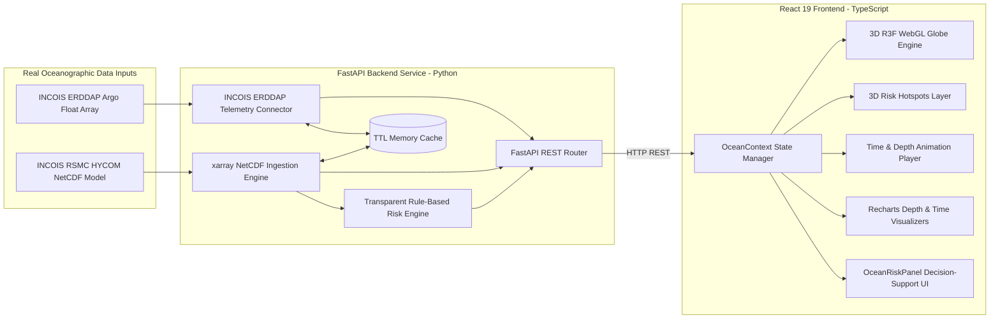

# OceanScope 🌊

> **"Explore the Ocean. Understand the Data."**  
> A scientific web platform integrating in-situ ocean observations, numerical ocean forecast models, and transparent disaster decision-support analytics.

[](#-getting-started)
[](#-technology-stack)
[](#-technology-stack)
[](#-technology-stack)
[](#-real-data-sources)

---

## 📌 Problem Statement
Oceanographic researchers, coastal managers, and disaster decision-support teams often struggle to simultaneously inspect multi-dimensional ocean data across depth and time, validate numerical ocean models against real-world observations, and evaluate marine hazards.

**OceanScope** bridges this gap by unifying:
1. **Real in-situ ocean observations** (INCOIS Argo floats and CTD depth profiles).
2. **Real numerical ocean model forecasts** (INCOIS RSMC HYCOM NetCDF grids).
3. **Statistical cross-validation** (model vs. observation bias, RMSE, MAE).
4. **Interactive 4D visualization** (3D WebGL globe with time and depth animation).
5. **Transparent rule-based ocean risk indicators** for disaster decision support.

---

## 🏗️ System Architecture



---

## 🎯 Key Platform Capabilities

### 1. 3D WebGL Ocean Globe & Subsurface Depths
- **Three.js & React Three Fiber (R3F)** interactive procedural sphere with latitude/longitude coordinate graticules and bioluminescent atmospheric glow.
- **Dynamic Subsurface Depth Layers**: Scaling concentric depth shells representing ocean layers from surface ($0\text{m}$) down to $5000\text{m}$.
- **Animated Ocean Current Flow Vectors**: Particle vector velocity system with depth-scaled speeds and trajectories.

### 2. Real INCOIS Argo Float Observations
- Live REST connector to the **INCOIS ERDDAP server** (`Indian_ARGO_Floats` dataset).
- Maps active float coordinates directly onto the 3D globe with interactive hover HUD cards.
- Full in-situ CTD vertical depth profiles (Temperature and Salinity vs. Pressure/Depth).

### 3. Real INCOIS HYCOM Numerical Model Integration
- Direct ingestion and indexing of official **INCOIS RSMC HYCOM NetCDF** datasets (`RSMC_hycom_20260829.nc`).
- Dynamic `xarray` coordinate discovery and slicing across latitude, longitude, depth, and time.
- REST endpoints for single-point queries, full vertical profiles, and vector current fields ($u, v$, speed, and direction).

### 4. Real Argo vs. HYCOM Cross-Validation Engine
- Automated spatial and temporal nearest-neighbor pairing between in-situ Argo observations and HYCOM model grid cells.
- Computes Haversine spatial distance ($\text{km}$) and time offset ($\text{hours}$).
- Calculates statistical error metrics across depth levels:
  - **Bias** (Mean Error) for Temperature & Salinity
  - **RMSE** (Root Mean Square Error)
  - **MAE** (Mean Absolute Error)
- Dual-overlay comparison charts with custom $\Delta$ deltas.

### 5. Time & Depth 4D Animation Player
- Timestep scrubber slider with instant UTC forecast tick jumping (`00:00Z`, `06:00Z`, `12:00Z`, `18:00Z`).
- Play/Pause animation with looping and variable speeds ($1\times, 2\times, 4\times$).
- Multi-level depth switcher ($0\text{m}, 10\text{m}, 50\text{m}, 100\text{m}, 500\text{m}, 1000\text{m}$).

### 6. Ocean Risk & Disaster Decision-Support System
- **Transparent Rule-Based Engine**: Auditable threshold rules configured in a single module ([`backend/app/core/risk_config.py`](backend/app/core/risk_config.py)).
- **Monitored Real Parameters**:
  - **Ocean Current Speed ($\text{m/s}$)**: Shear and navigation hazard.
  - **SST Anomaly ($\text{°C}$)**: Thermal departure indicating Marine Heatwaves (MHW).
  - **Sea Surface Height / SSH ($\text{m}$)**: Surge and dynamic sea-level elevation.
  - **Tropical Cyclone Heat Potential / TCHP ($\text{kJ/cm}^2$)**: Upper ocean thermal energy fueling rapid cyclone intensification.
  - **Mixed Layer Depth / MLD ($\text{m}$)**: Upper ocean density layer thickness.
- **3D Risk Hotspots Layer**: Pulsing beacon halos indicating high-hazard zones on the globe.
- **Interactive Location Assessment**: Click anywhere on the 3D globe to compute the exact risk profile for that coordinate.
- **"Why this risk?" Section**: Explicitly displays the triggering parameter, observed value, threshold rule applied, verified data source, and timestamp.

---

## ⚖️ LIVE Mode vs. DEMO Mode

| Feature | LIVE Mode (`Source: INCOIS`) | DEMO Mode (`Source: Local Demo Dataset`) |
| :--- | :--- | :--- |
| **Argo Telemetry** | Live INCOIS ERDDAP operational array | Calibrated local observation baseline |
| **Model Fields** | Ingested INCOIS RSMC HYCOM NetCDF file | Local test model scenarios |
| **Missing Variables** | Explicitly marked `NOT IN DATASET` (no synthetic fabrication) | Synthetic demo values for testing UI |
| **Internet Dependency** | Queries local backend + INCOIS ERDDAP | 100% offline standalone operation |

---

## ⚠️ Important Advisory Disclaimer

> **Demonstration Notice**: OceanScope risk indicators and hazard assessments are demonstration decision-support visualizations and are **not** official government warnings or certified operational forecasts.

---

## 🛠️ Technology Stack

### Frontend Application
- **Framework:** React 19, TypeScript, Vite
- **3D Engine:** Three.js, `@react-three/fiber`, `@react-three/drei`
- **Analytics & Charts:** Recharts
- **Styling:** Tailwind CSS, Lucide React icons
- **State Management:** React Context (`OceanContext`)

### Backend Application
- **Framework:** Python 3.10+, FastAPI, Uvicorn
- **Scientific Computing:** `xarray`, `netCDF4`, `numpy`, `pandas`
- **HTTP Client:** `httpx` with in-memory TTL caching
- **Data Validation:** Pydantic v2

---

## 🚀 Getting Started & Setup Instructions

### Prerequisites
- Node.js 18+ and npm
- Python 3.10+ (or Anaconda / Miniconda)

---

### Backend Setup

1. **Navigate to the backend directory**:
   ```bash
   cd backend
   ```

2. **Install Python dependencies**:
   ```bash
   pip install -r requirements.txt
   ```

3. **Verify or place the INCOIS NetCDF dataset**:
   Ensure `RSMC_hycom_20260829.nc` is placed in:
   ```
   backend/data/netcdf/hycom/RSMC_hycom_20260829.nc
   ```

4. **Run the FastAPI server**:
   ```bash
   uvicorn main:app --host 0.0.0.0 --port 8000 --reload
   ```
   * Swagger Documentation: `http://localhost:8000/docs`
   * Health Check: `http://localhost:8000/health`

---

### Frontend Setup

1. **Navigate to the frontend directory**:
   ```bash
   cd frontend
   ```

2. **Install Node dependencies**:
   ```bash
   npm install
   ```

3. **Start the Vite development server**:
   ```bash
   npm run dev
   ```
   * Open `http://localhost:5173` in your browser.

4. **Production Build**:
   ```bash
   npm run build
   ```

---

## 🧪 Automated Testing & Verification

Run the Python verification test suite:
```bash
# 1. Multi-file HYCOM engine
python scripts/test_multi_file_hycom.py

# 2. Ocean Risk evaluation
python scripts/test_risk_service.py

# 3. Backend performance benchmarks
python scripts/test_performance.py

# 4. Scientific data quality control (90 tests)
python scripts/test_quality_control.py

# 5. Frontend production build
cd frontend && npm run build
```

---

## ⚙️ Environment Variables

Copy `.env.example` to `.env` and configure:

| Variable | Default | Description |
| :--- | :--- | :--- |
| `VITE_API_BASE_URL` | `http://localhost:8000/api/v1` | Frontend API endpoint |
| `VITE_APP_TITLE` | `OceanScope` | Browser tab title |
| `HOST` | `0.0.0.0` | Backend bind address |
| `PORT` | `8000` | Backend port |
| `DEBUG` | `false` | Enable debug logging and /docs |
| `CORS_ORIGINS` | `*` | Comma-separated allowed origins |
| `INCOIS_ERDDAP_BASE_URL` | `https://erddap.incois.gov.in/erddap/` | Argo data source |
| `HYCOM_DATA_DIRECTORY` | `backend/data/netcdf/hycom` | NetCDF file storage |
| `HTTP_TIMEOUT_SECONDS` | `10` | ERDDAP request timeout |
| `CACHE_EXPIRATION_SECONDS` | `600` | Query cache TTL |

---

## 📋 REST API Endpoints

| Method | Endpoint | Description |
| :--- | :--- | :--- |
| `GET` | `/api/v1/observations/argo` | Live INCOIS ERDDAP Argo float spatial coordinates |
| `GET` | `/api/v1/observations/argo/profile` | In-situ CTD vertical depth profile for a float |
| `GET` | `/api/v1/models/hycom/metadata` | Dimensions and mapped variables in active NetCDF |
| `GET` | `/api/v1/models/hycom/point` | Point query for `(lat, lon, depth, variable, time)` |
| `GET` | `/api/v1/models/hycom/profile` | Vertical model profile for `(lat, lon, time)` |
| `GET` | `/api/v1/models/hycom/current` | Velocity vector $(u, v)$ and speed at coordinate |
| `GET` | `/api/v1/models/hycom/timeseries` | Time-series extraction across multi-file catalog |
| `GET` | `/api/v1/models/hycom/compare-argo` | Real Argo vs. HYCOM cross-validation metrics |
| `GET` | `/api/v1/models/hycom/cache-stats` | In-memory cache performance statistics |
| `GET` | `/api/v1/disasters/alerts` | Regional hazard hotspot indicators |
| `GET` | `/api/v1/disasters/risk-at-point` | Rule-based risk at any arbitrary coordinate |
| `GET` | `/api/v1/disasters/thresholds` | Auditable risk threshold configuration |
| `GET` | `/api/v1/data/status` | Live INCOIS connectivity and dataset status |
| `POST` | `/api/v1/data/refresh` | Force refresh caches and re-check data feeds |

---

## 🔄 Data Refresh Mechanism

### Automatic HYCOM Dataset Ingestion
```bash
python scripts/update_incois_hycom.py [optional_path_to_new_nc_file]
```
- Validates new NetCDF files with xarray (dimensions, variables, time range)
- Activates valid datasets in the multi-file catalog without downtime
- Preserves existing valid files as fallback

### Argo Float Data
- Live real-time queries to INCOIS ERDDAP on each API call
- Automatic fallback to Demo Mode if ERDDAP is unreachable

---

## 🔬 Data Quality Control

See [`docs/data/quality_control.md`](docs/data/quality_control.md) for detailed QC documentation.

- **Argo QC**: IOC/WMO QC flag filtering (flags 1-2 accepted, 3-4-9 rejected)
- **Physical Limits**: Temperature −2.5 to 40.0°C, Salinity 0.0 to 45.0 PSU
- **Fill Values**: NaN, ±999, ±9999, 1e20, 1e30 automatically detected and rejected
- **Metrics**: Bias/RMSE/MAE computed only over valid non-null paired observations
- **Per-response metadata**: `valid_count`, `missing_count`, `qc_pass_count`, `qc_fail_count`

---

## 🚀 Production Deployment Architecture

OceanScope uses a decoupled, hybrid cloud deployment architecture designed for scientific oceanographic data workloads:

```text
┌─────────────────────────────────────────────────────────────┐
│                      VERCEL EDGE CDN                        │
│             React 19 + Vite + Three.js Frontend             │
│               (Configured via VITE_API_URL)                 │
└──────────────────────────────┬──────────────────────────────┘
                               │ HTTPS REST API
┌──────────────────────────────▼──────────────────────────────┐
│                  PERSISTENT BACKEND SERVER                  │
│       FastAPI + Python 3.11 + xarray + NetCDF4 Engine       │
│                  (Runs 24/7 on VM / Container)              │
└──────────────┬──────────────────────────────┬───────────────┘
               │ Local I/O                    │ HTTPS REST
┌──────────────▼──────────────┐ ┌─────────────▼───────────────┐
│  EXTERNAL PERSISTENT VOLUME │ │        INCOIS ERDDAP        │
│       Mounted at:           │ │   Live Argo Float Telemetry │
│       /data/hycom           │ │   In-situ CTD Profile Feeds │
│   (RSMC_hycom_*.nc Files)   │ └─────────────────────────────┘
└─────────────────────────────┘
```

> [!IMPORTANT]
> **Why HYCOM NetCDF Datasets are Stored Separately:**
> Real operational ocean forecast files (`RSMC_hycom_*.nc`) range from **6 GB to 10+ GB each**. They are excluded from Git repository commits and Vercel builds via `.gitignore` and `.dockerignore`. Instead, they reside on a persistent block storage volume mounted directly to the FastAPI backend at `/data/hycom`.

---

### 1. Frontend Deployment (Vercel)

- **Framework Preset**: Vite
- **Root Directory**: `OceanScope/frontend` (or repository root using provided `vercel.json`)
- **Build Command**: `npm run build`
- **Output Directory**: `dist`
- **Required Environment Variable**:
  ```env
  VITE_API_URL=https://api.your-oceanscope-backend.com
  ```
- **SPA Routing**: Handled automatically by `vercel.json` rewrites (prevents 404 on `/explorer`, `/observations`, `/analytics`).

---

### 2. Backend Server Deployment (Persistent Server / VM / Docker)

Because NetCDF operations require `xarray`, `libnetcdf`, and persistent disk access to large multi-gigabyte arrays, the backend must run on a persistent container or virtual machine (AWS EC2, GCP Compute Engine, DigitalOcean Droplet, Railway, Render with persistent disk):

- **Python Version**: `3.11+`
- **System Libraries**: `libhdf5-dev`, `libnetcdf-dev`
- **Memory Recommendation**: 4 GB+ RAM (8 GB recommended for concurrent NetCDF slicing)
- **Persistent Storage**: 20 GB+ SSD volume mounted at `/data/hycom`
- **Startup Command**:
  ```bash
  uvicorn main:app --host 0.0.0.0 --port ${PORT:-8000}
  ```
- **Required Environment Variables**:
  ```env
  HOST=0.0.0.0
  PORT=8000
  DEBUG=false
  CORS_ALLOWED_ORIGINS=https://your-oceanscope.vercel.app
  HYCOM_DATA_DIRECTORY=/data/hycom
  INCOIS_ERDDAP_BASE_URL=https://erddap.incois.gov.in/erddap/
  ```

---

### 3. Docker & Container Deployment

```bash
# Build and run backend container with persistent storage volume
docker build -t oceanscope-backend ./backend
docker run -d \
  -p 8000:8000 \
  -e CORS_ALLOWED_ORIGINS="https://your-app.vercel.app" \
  -e HYCOM_DATA_DIRECTORY="/data/hycom" \
  -v /var/data/hycom:/data/hycom:ro \
  --name oceanscope-backend \
  oceanscope-backend
```

---

## 📁 NetCDF Requirements

- **Format**: NetCDF4 (`.nc`)
- **Naming**: `RSMC_hycom_YYYYMMDD.nc`
- **Required dimensions**: `latitude`, `longitude`, `time`, `depth`
- **Required variables**: `TEMP`/`temperature`, `SALN`/`salinity`, `UVEL`/`current_u`, `VVEL`/`current_v`
- **Location**: `backend/data/netcdf/hycom/`

---

## 🔍 Known Limitations

1. **NetCDF Spatial Bounds**: Real HYCOM NetCDF fields are bounded by the INCOIS RSMC model grid (0°–30°N, 45°–100°E). Coordinates outside this domain use nearest-grid indexing.
2. **Fixed Climatological Baseline**: SST anomaly references a regional seasonal mean (28.0°C) rather than multi-decade gridded daily climatologies.
3. **Deterministic Rules**: Risk assessments use rule-based thresholds rather than probabilistic ML models.
4. **Nearest-Neighbour Only**: No spatial or temporal interpolation — the nearest grid cell and timestep are used.
5. **Pressure ≈ Depth**: 1 dbar ≈ 1 m approximation (accurate within ~2% in the upper 2000 m).
6. **No Argo Delayed-Mode QC**: INCOIS ERDDAP real-time feed does not expose per-level QC flag columns.

---

## 📄 License
Developed for the Smart India Hackathon (SIH) Oceanography & Disaster Management initiative. All rights reserved.

