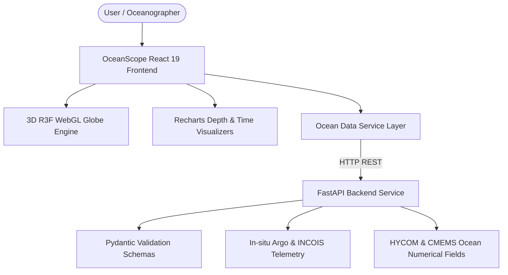

# OceanScope 🌊

> **"Explore the Ocean. Understand the Data."**

[](#-getting-started)
[](#-technology-stack)
[](#-technology-stack)
[](#-technology-stack)

---

## 📌 Problem Statement
Develop a web-based interactive 3D visualization platform that integrates numerical ocean model outputs and in-situ ocean observations to assist researchers, oceanographers, and disaster management teams in understanding complex ocean conditions.

---

## 🎯 Key Capabilities & Platform Features

- **3D Ocean Explorer**: Interactive 3D WebGL sphere powered by Three.js & React Three Fiber featuring procedural thermal heatmaps, lat/lon coordinate graticule lines, and bioluminescent atmosphere glow.
- **In-Situ Observation Telemetry**: Real-time spatial markers for Argo float arrays and INCOIS moored buoys with interactive hover telemetry cards.
- **Dynamic Ocean Circulation Vectors**: 3D current flow particle system animating global circulation patterns.
- **Vertical Depth Profile Visualizer**: Recharts dual-axis vertical series (0–1000m depth) comparing sea temperature (°C) and salinity (PSU).
- **SST Anomaly Timeline**: Area chart tracking sea surface temperature trends against 30-year climatological baselines.
- **Numerical Model vs Observation Comparison**: Direct overlay chart evaluating prediction bias between HYCOM model outputs and in-situ float data.
- **Ocean Risk & Disaster Indicators**: Automated anomaly detection for marine heatwaves and coastal current shears.

---

## 🏗️ Architecture Overview



---

## 🛠️ Technology Stack

### Frontend Application
- **Core Framework:** React 19, TypeScript, Vite
- **3D Engine:** Three.js, `@react-three/fiber`, `@react-three/drei`
- **Charts & Visuals:** Recharts
- **Styling & UI:** Tailwind CSS, Lucide React
- **Routing:** React Router v7

### Backend Application
- **Framework:** Python, FastAPI, Uvicorn
- **Data Validation:** Pydantic v2
- **Data Formats:** NetCDF4, GeoJSON, CSV

---

## 📁 Repository Directory Structure

```
OceanScope/
├── frontend/                  # React 19 + TypeScript + Vite Frontend Application
│   ├── public/                # Favicon and static web assets
│   ├── src/
│   │   ├── assets/            # Images and icons
│   │   ├── components/        # Reusable UI primitives and layout components
│   │   │   ├── common/        # Header, Footer, Button, Card, Badge, StatCard
│   │   │   ├── layout/        # Navbar, MainLayout
│   │   │   ├── dashboard/     # DashboardGrid, SystemStatusCard, QuickMetrics
│   │   │   ├── observations/  # ObservationFilter, ObservationTablePlaceholder
│   │   │   ├── analytics/     # AnalyticsPanelPlaceholder
│   │   │   ├── comparison/    # ModelComparisonPlaceholder
│   │   │   ├── disaster/      # DisasterIndicatorCard
│   │   │   └── charts/        # DepthProfileChart, SstTimeSeriesChart, etc.
│   │   ├── pages/             # App routes (Home, Dashboard, Explorer, etc.)
│   │   ├── three/             # 3D Globe, Atmosphere, Points, & Current layers
│   │   ├── hooks/             # Custom React hooks (useOceanData, useGlobeControls)
│   │   ├── services/          # API client & OceanDataService
│   │   ├── store/             # OceanContext state manager
│   │   ├── data/              # Mock datasets & ocean constants
│   │   ├── types/             # Domain TypeScript interfaces
│   │   ├── utils/             # Formatters, coordinate math, spherical vectors
│   │   ├── config/            # Centralized application settings
│   │   ├── App.tsx            # Main route wrapper
│   │   ├── main.tsx           # DOM entrypoint
│   │   └── index.css          # Tailwind CSS directives
│   ├── package.json
│   ├── tsconfig.json
│   ├── vite.config.ts
│   └── README.md
├── backend/                   # FastAPI Python Service
│   ├── app/
│   │   ├── api/routes/        # REST endpoints (observations, models, disasters)
│   │   ├── core/              # App settings & config
│   │   ├── schemas/           # Pydantic data schemas
│   │   └── services/          # Backend ocean data slicing engine
│   ├── main.py                # FastAPI entrypoint
│   ├── requirements.txt
│   └── README.md
├── docs/                      # Technical Documentation
│   ├── api/specifications.md  # API endpoints specification
│   ├── architecture/overview.md # Architectural design & diagrams
│   └── project-notes/hackathon-notes.md # Development roadmap & progress
├── scripts/                   # Setup scripts
├── .env.example
├── .gitignore
└── README.md
```

---

## 🚀 Getting Started & How to Run

### Prerequisites
- **Node.js**: v18.0.0 or higher
- **Python**: v3.10 or higher
- **npm**: v9.0.0 or higher

---

### Running the Frontend

1. Navigate to the `frontend/` directory:
   ```bash
   cd OceanScope/frontend
   ```

2. Install dependencies:
   ```bash
   npm install
   ```

3. Start the local Vite development server:
   ```bash
   npm run dev
   ```
   Open `http://localhost:3000` in your web browser.

4. Run production build verification:
   ```bash
   npm run build
   ```

---

### Running the Backend

1. Navigate to the `backend/` directory:
   ```bash
   cd OceanScope/backend
   ```

2. Install backend dependencies:
   ```bash
   pip install -r requirements.txt
   ```

3. Start the FastAPI development server with Uvicorn:
   ```bash
   uvicorn main:app --reload --port 8000
   ```
   Access the interactive Swagger API documentation at `http://localhost:8000/docs`.

---

## 📜 License
Built for Hackathon Project "OceanScope". MIT License.
