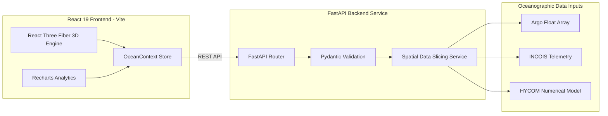

# OceanScope Technical Architecture Overview

## 1. System Design & Vision
OceanScope is engineered as a decoupled scientific oceanography platform.

## 2. 3D WebGL Coordinates & Vector Math
Geographical spherical coordinates `(lat, lon, depth)` are converted to 3D scene coordinates `Vector3(x, y, z)` on a sphere of radius \( R \):

\[
x = -(R \cdot \sin(\phi) \cdot \cos(\theta))
\]
\[
y = R \cdot \cos(\phi)
\]
\[
z = R \cdot \sin(\phi) \cdot \sin(\theta)
\]

where \(\phi = (90^\circ - \text{lat}) \cdot \frac{\pi}{180}\) and \(\theta = (\text{lon} + 180^\circ) \cdot \frac{\pi}{180}\).

---

## 3. Data Integration Layers
- **In-Situ Observations**: Ingests temperature, salinity, and current velocity from Argo floats and INCOIS buoys.
- **Numerical Ocean Models**: Integrates surface and subsurface velocity fields from HYCOM and CMEMS models.
- **Anomaly Detection**: Computes SST variance relative to 30-year climatological mean baselines to trigger marine heatwave alerts.
