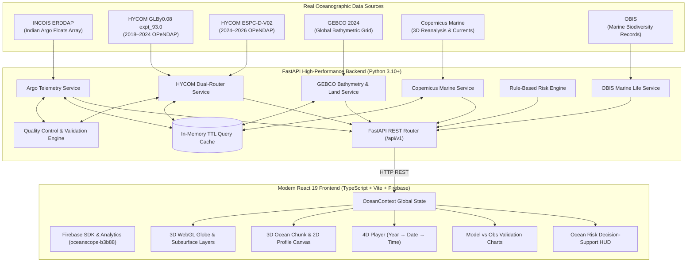

# OceanScope 🌊

### Interactive 3D Ocean Visualization & Model Validation
> **"See the Ocean. Understand the Data."**

[](https://oceanscope-b3b88.web.app)
[](https://fastapi.tiangolo.com)
[](https://react.dev)
[](https://threejs.org)
[](https://incois.gov.in)
[](https://www.gebco.net)
[](https://marine.copernicus.eu)
[](https://obis.org)

---

## ⚡ Quick Start & Deployment

### 1. Local Development Launch
```bash
# 1. Start the Backend (FastAPI on Port 8000)
cd OceanScope/backend
pip install -r requirements.txt
python -m uvicorn main:app --host 127.0.0.1 --port 8000 --reload

# 2. Start the Frontend (Vite on Port 5173 in a new terminal)
cd OceanScope/frontend
npm install
npm run dev
```
* **Web Application:** [http://localhost:5173](http://localhost:5173)
* **API Documentation (Swagger):** [http://127.0.0.1:8000/docs](http://127.0.0.1:8000/docs)
* **Backend Health Check:** [http://127.0.0.1:8000/api/v1/health](http://127.0.0.1:8000/api/v1/health)

---

### 2. 🔥 Deploy to Firebase Hosting

OceanScope is pre-configured with Firebase Hosting (`oceanscope-b3b88`):

```bash
# 1. Install Firebase CLI globally (if not already installed)
npm install -g firebase-tools

# 2. Authenticate with your Google / Firebase account
firebase login

# 3. Build & Deploy to Firebase Hosting
cd OceanScope/frontend
npm run build
cd ../..
firebase deploy --only hosting
```

Your web application will be live at:
- **Primary Domain:** [https://oceanscope-b3b88.web.app](https://oceanscope-b3b88.web.app)
- **Secondary Domain:** [https://oceanscope-b3b88.firebaseapp.com](https://oceanscope-b3b88.firebaseapp.com)

---

## 1. 📌 Project Overview
**OceanScope** is an advanced scientific web platform designed to bridge the gap between operational ocean observations and numerical ocean forecasts. By unifying in-situ marine telemetry, multi-source hydrodynamic models, high-resolution seafloor bathymetry, and marine biodiversity occurrences, OceanScope provides researchers, coastal authorities, and disaster response teams with an intuitive, physically accurate 4D decision-support dashboard.

---

## 2. 🎯 Problem Statement
Oceanographers and coastal decision-makers face three major bottlenecks:
1. **Data Fragmentation:** Real-world in-situ float observations (Argo), numerical models (HYCOM, Copernicus), seabed topography (GEBCO), and biological distributions (OBIS) exist in siloed formats (NetCDF, OPeNDAP, ERDDAP, REST) with differing coordinate frames and vertical depth intervals.
2. **Model Uncertainty:** Numerical forecast models frequently suffer from depth-dependent drift and biases that cannot be verified without real-time cross-validation against physical float soundings.
3. **Hazard Communication:** Raw numerical parameter anomalies (elevated SST, velocity shear, storm surges) lack transparent, auditable decision thresholds, resulting in opaque hazard reporting.

**OceanScope solves this** by executing automated spatial/temporal pairing, computing rigorous statistical error metrics (Bias, RMSE, MAE), rendering interactive 3D/2D volumetric ocean chunks, and evaluating transparent rule-based hazard indicators.

---

## 3. ✨ Key Features

1. **Interactive 3D WebGL Globe & Subsurface Depths**
   - Procedural 3D Earth sphere with high-resolution NASA Blue Marble texturing and atmospheric glow.
   - Dynamic subsurface depth shells slicing ocean layers from surface ($0\,\text{m}$) to abyss ($5000\,\text{m}$).
   - Animated vector particle flows displaying directional velocity fields.

2. **Full Multi-Year HYCOM Historical & Modern Time Selection**
   - Intelligent dual-catalog routing covering 2018 to 2026 at 3-hour temporal resolution:
     - **Historical Archive:** `GLBy0.08 / expt_93.0` (2018–2024).
     - **Operational/Current Product:** `ESPC-D-V02` (2024–2026).
   - Unified **Year $\to$ Date $\to$ Time** picker requesting real OPeNDAP slices without requiring local 10GB downloads.

3. **3D Ocean Chunk & 2D Real-Depth Stratigraphy**
   - Volumetric 3D water column visualization bounded by actual **GEBCO 2024** bathymetric seabed meshes.
   - 2D vertical profile canvas illustrating water-column thermocline and halocline stratigraphy.
   - **Physical Land Classification:** Real GEBCO elevation check ($elevation \ge 0$) automatically detects land coordinates and presents a dedicated empty-state interface rather than fabricating synthetic ocean depths.

4. **In-situ Argo Float Telemetry & Cross-Validation**
   - Live REST connector to **INCOIS ERDDAP** (`Indian_ARGO_Floats`) with IOC/WMO QC flag filtering.
   - Automated spatial nearest-neighbor discovery matching Argo CTD casts to numerical model grid points.
   - Real-time statistical error calculation (**Bias**, **RMSE**, **MAE**) across vertical depth soundings.

5. **Transparent Rule-Based Ocean Risk Indicators**
   - Auditable threshold rules monitoring Marine Heatwave (MHW) SST anomalies, current shear, Sea Surface Height (SSH) surge, Tropical Cyclone Heat Potential (TCHP), and Mixed Layer Depth (MLD).
   - Instant "Why this risk?" rationale explaining the exact observed value, applied threshold, and data provenance.

6. **Depth-Aware OBIS Marine Biodiversity Integration**
   - Dynamic extraction of authenticated marine taxa records matched to local depth zones (Epipelagic $0\text{--}50\,\text{m}$, Continental Shelf $50\text{--}200\,\text{m}$, Mesopelagic $200\text{--}1000\,\text{m}$).

---

## 4. 🏗️ System Architecture



---

## 5. 🌐 Data Sources

| Source | Provider | Parameters Provided | Temporal Coverage | Resolution | Access Method |
| :--- | :--- | :--- | :--- | :--- | :--- |
| **Argo Floats** | INCOIS ERDDAP | In-situ Temperature, Salinity, Pressure | Operational (Live) | Float Trajectories | REST TableDAP |
| **HYCOM Archive** | NOAA / FSU | Temperature, Salinity, U/V Currents, SSH | Dec 2018 – Aug 2024 | $0.08^\circ$ (3-hourly) | OPeNDAP NetCDF Slicing |
| **HYCOM Modern** | NOAA / NCODA | Temperature, Salinity, U/V Currents, SSH | Aug 2024 – Present | $0.08^\circ$ (3-hourly) | OPeNDAP NetCDF Slicing |
| **GEBCO 2024** | IHO / IOC GEBCO | Seafloor Bathymetry & Land Elevation | Static Baseline | 15 arc-second grid | Programmatic Subsetting |
| **Copernicus Marine** | E.U. Copernicus | Temperature, Salinity, Geostrophic Currents, MLD | 2020 – Present | $0.125^\circ$ (Daily) | Copernicus Marine SDK |
| **OBIS** | UNESCO / IOC | Depth-Stratified Marine Species Occurrences | Historical & Modern | Global Point Records | REST API v3 |

---

## 6. 🔬 Scientific Processing & Quality Control

### Coordinate & Unit Normalization
- **Longitude Mapping:** Automatically transforms longitudes across coordinate standards ($0^\circ \dots 360^\circ \leftrightarrow -180^\circ \dots 180^\circ$).
- **Depth Matching:** Interpolates non-uniform observational CTD pressure soundings ($\text{dbar}$) to numerical model standard depth levels ($\text{m}$).
- **Canonical Units:** Strict enforcement of standard units ($^\circ\text{C}$, $\text{PSU}$, $\text{m/s}$, $\text{m}$, $\text{kJ/cm}^2$).

### Data Quality Control (QC)
- Adheres to **IOC/WMO Argo QC Flags**: Accepts flags `1` (Good) and `2` (Probably Good); rejects `3` (Bad), `4` (Gross Error), and `9` (Missing).
- **Physical Bounds Filtering:**
  - Water Temperature: $-2.5^\circ\text{C} \le T \le 40.0^\circ\text{C}$
  - Practical Salinity: $0.0\,\text{PSU} \le S \le 45.0\,\text{PSU}$
  - Current Speed: $0.0\,\text{m/s} \le V \le 10.0\,\text{m/s}$
  - Fill Value Detection: Automatically discards $\pm 999$, $\pm 9999$, $1\times 10^{20}$, $\text{NaN}$, and $\text{Inf}$.

---

## 7. 📊 Statistical Model Validation

OceanScope performs paired point-by-point cross-validation between numerical forecasts ($M_k$) and in-situ observational soundings ($O_k$) across matched depth levels:

### 1. Mean Bias (Systematic Model Drift)
$$\text{Bias} = \frac{1}{N} \sum_{k=1}^{N} (M_k - O_k)$$

### 2. Root Mean Square Error (Magnitude of Discrepancy)
$$\text{RMSE} = \sqrt{\frac{1}{N} \sum_{k=1}^{N} (M_k - O_k)^2}$$

### 3. Mean Absolute Error (Average Deviation)
$$\text{MAE} = \frac{1}{N} \sum_{k=1}^{N} |M_k - O_k|$$

---

## 8. 📦 3D Ocean Chunk & Land Classification

When exploring local ocean regions, OceanScope provides a high-resolution 3D volumetric chunk:
- **Bathymetric Mesh:** Dynamically samples a 2D elevation grid from GEBCO 2024 to render the true seabed topography.
- **Water Column Stratification:** Renders thermocline color layers from surface to seabed.
- **Physical Land Protection:** If the user selects a terrestrial coordinate ($elevation \ge 0\,\text{m}$), OceanScope suppresses the 3D ocean simulation and displays a dedicated **Coastal/Land State** card detailing elevation, preventing artificial 0m ocean simulations on land.

---

## 9. ⚠️ Transparent Ocean Risk Indicators

| Risk Category | Key Parameter | Low | Moderate | High | Critical |
| :--- | :--- | :--- | :--- | :--- | :--- |
| **Marine Heatwaves (MHW)** | SST Anomaly ($^\circ\text{C}$) | $< +1.00$ | $+1.00 \dots +1.80$ | $+1.80 \dots +2.50$ | $\ge +2.50$ |
| **Ocean Current Shear** | Velocity Speed ($\text{m/s}$) | $< 0.50$ | $0.50 \dots 0.90$ | $0.90 \dots 1.40$ | $\ge 1.40$ |
| **Dynamic Sea Level Surge** | SSH ($\text{m}$) | $< 0.20$ | $0.20 \dots 0.35$ | $0.35 \dots 0.60$ | $\ge 0.60$ |
| **Cyclone Thermal Potential** | TCHP ($\text{kJ/cm}^2$) | $< 40.0$ | $40.0 \dots 65.0$ | $65.0 \dots 90.0$ | $\ge 90.0$ |
| **Upper Ocean Mixing** | MLD ($\text{m}$) | $> 60.0$ | $40.0 \dots 60.0$ | $20.0 \dots 40.0$ | $\le 20.0$ |

---

## 10. 💻 Technology Stack

### Frontend
- **Framework:** React 19, TypeScript, Vite
- **Hosting & Analytics:** Firebase Hosting & Firebase Analytics (`oceanscope-b3b88`)
- **3D Visualization:** Three.js, `@react-three/fiber`, `@react-three/drei`
- **Charts & Visuals:** Recharts, HTML5 Canvas 2D
- **Styling:** Tailwind CSS, Lucide React icons
- **State Management:** React Context (`OceanContext`)

### Backend
- **Framework:** Python 3.10+, FastAPI, Uvicorn
- **Scientific Computing:** `xarray`, `netCDF4`, `numpy`, `pandas`
- **Networking & Cache:** `httpx`, In-Memory Thread-Safe TTL Query Cache
- **Validation:** Pydantic v2

---

## 11. 📁 Project Structure

```
OceanScope/
├── backend/
│   ├── app/
│   │   ├── api/routes/           # REST endpoints (models, obs, bathymetry, disasters, etc.)
│   │   ├── core/                 # Config, Quality Control, TTL Cache, Risk Thresholds
│   │   ├── schemas/              # Pydantic schemas (HYCOM, Argo, Risk, Bathymetry)
│   │   └── services/             # Remote HYCOM dual-router, Argo ERDDAP, GEBCO, Copernicus, OBIS
│   ├── data/                     # NetCDF storage directory & demo baselines
│   ├── tests/                    # Automated test suites
│   ├── Dockerfile                # Container deployment file
│   ├── main.py                   # FastAPI application entrypoint
│   └── requirements.txt          # Python dependencies
├── frontend/
│   ├── src/
│   │   ├── components/           # 3D Ocean Chunk, Timeline Player, Risk Panel, Argo HUD
│   │   ├── config/               # Firebase configuration & app settings
│   │   ├── services/             # Typed API clients for backend endpoints
│   │   ├── store/                # OceanContext global state manager
│   │   ├── three/                # Three.js globe, depth shells, particle flows
│   │   └── types/                # TypeScript interfaces
│   ├── firebase.json             # Firebase hosting config
│   ├── package.json              # Node.js dependencies (including firebase SDK)
│   └── vite.config.ts            # Vite build configuration
├── .firebaserc                   # Firebase project target (oceanscope-b3b88)
├── firebase.json                 # Root Firebase Hosting configuration
├── vercel.json                   # Vercel deployment configuration
├── .env.example                  # Environment configuration template
└── README.md                     # GitHub Project Documentation
```

---

## 12. 🔌 REST API Reference

| Method | Endpoint | Description |
| :--- | :--- | :--- |
| `GET` | `/api/v1/health` | System health check & service status |
| `GET` | `/api/v1/observations/argo` | Live in-situ Argo float spatial coordinates |
| `GET` | `/api/v1/observations/argo/profile` | Real vertical CTD depth profile for a float |
| `GET` | `/api/v1/models/hycom/metadata` | Metadata & variables from active HYCOM catalog |
| `GET` | `/api/v1/models/hycom/timestamps` | Available Year $\to$ Date $\to$ Time list |
| `GET` | `/api/v1/models/hycom/point` | Point query for `(lat, lon, depth, variable, time)` |
| `GET` | `/api/v1/models/hycom/profile` | Vertical model profile for `(lat, lon, time)` |
| `GET` | `/api/v1/models/hycom/current` | Velocity vector $(u, v)$, speed, and direction |
| `GET` | `/api/v1/models/hycom/timeseries` | Time-series query across multi-year catalog |
| `GET` | `/api/v1/models/hycom/compare-argo` | Argo vs. HYCOM statistical cross-validation metrics |
| `GET` | `/api/v1/bathymetry/point` | GEBCO elevation & bathymetric depth at coordinate |
| `GET` | `/api/v1/bathymetry/chunk` | 2D GEBCO elevation grid for 3D ocean chunk |
| `GET` | `/api/v1/disasters/alerts` | Regional hazard hotspot indicators |
| `GET` | `/api/v1/disasters/risk-at-point` | Rule-based risk evaluation at any arbitrary coordinate |
| `GET` | `/api/v1/marine-life/species` | OBIS depth-filtered marine species occurrences |
| `GET` | `/api/v1/data/status` | Live feed connectivity & telemetry status |

---

**OceanScope** — *Engineered for Oceanographic Clarity.*
